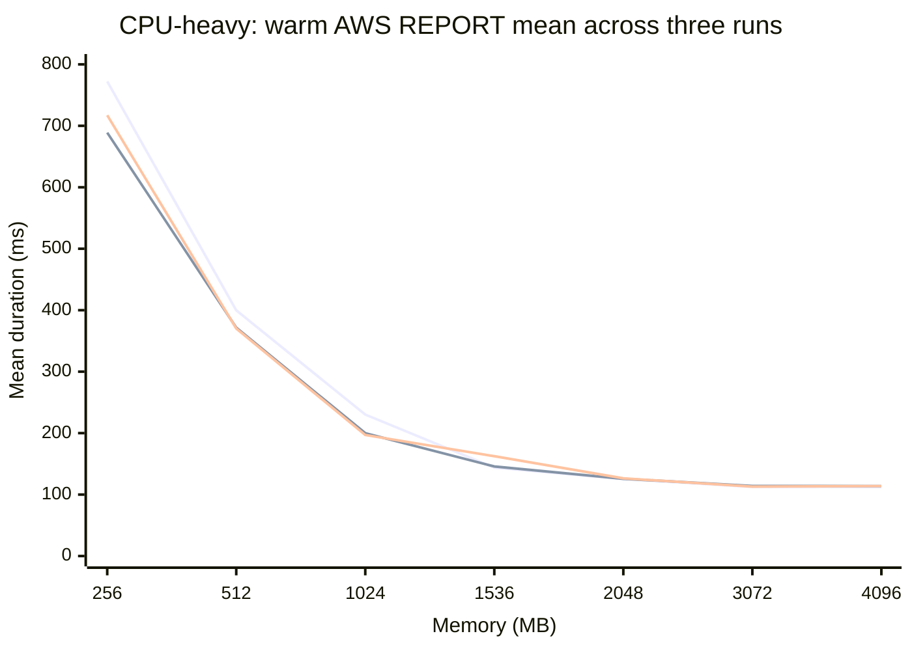
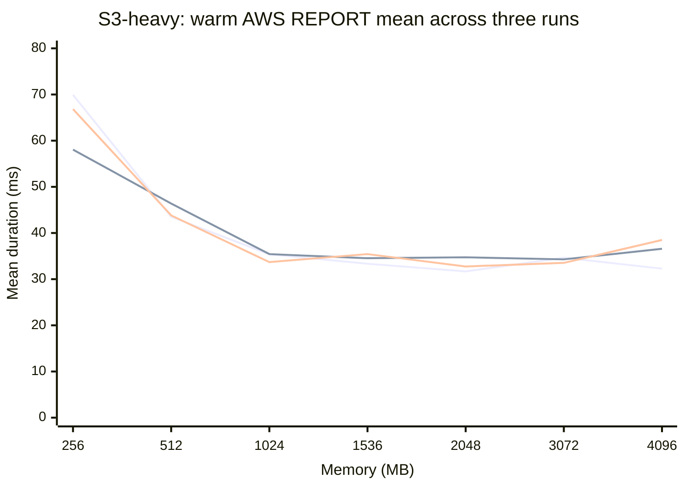

# How Much Memory Does a Java Lambda Really Need?

## CPU-heavy vs S3-heavy workloads on AWS Lambda

> **Experiment completed October 2026.** This article reports three full AWS benchmark runs (9, 14 and 19 October) and two LocalStack experiments (14 and 19 October). Results concern primarily **warm execution** and **billed Lambda compute consumption**, not a complete production cost model.

## Update: two full runs on 28 October

Two additional runs cover **11 memory settings**, including 1769, 6144, 8192 and 10,240 MB, in both AWS and LocalStack. Each run completed **1,452 valid invocations per environment**, with **60 warm collected samples per workload and memory setting**, and no failed or invalid calls. AWS ran in **eu-west-1**, whereas the historical results below use eu-west-2. Both AWS runs restored 1024 MB, and both local matrices cleaned up their temporary resources.

Each AWS matrix was split into two batches to retain the runner's 1,000-invocation limit. Calls were sequential within each environment; AWS and LocalStack matrices ran concurrently. These repeated runs share the same deployment and local host, so they are not independent hardware replications.


The second graph uses **handlerMs in both environments**. LocalStack configured memory does not establish equivalent AWS CPU allocation or production performance. Settings on the horizontal axes are equally spaced for readability.

[All updated graphs, including billed compute and downloadable SVGs](benchmark-runs/20261028-two-runs/README.md) · [Measurements and p95 values](benchmark-runs/20261028-two-runs/measurements.csv) · [Exact source run folders](benchmark-runs/20261028-two-runs/sources.json)

The remaining sections retain the original three-day experiment and its results.

## Why I started this

Attending AWS Community Summit Birmingham and Manchester in 2026 left me wanting to build something practical. The enthusiasm of [🐔 Guilherme Dalla Rosa](https://www.linkedin.com/in/guidr/), [Matheus das Mercês](https://www.linkedin.com/search/results/people/?keywords=Matheus%20das%20Merc%C3%AAs), [Robin Ford](https://www.linkedin.com/search/results/people/?keywords=Robin%20Ford%20AWS%20Accenture) and [Yan Cui](https://www.linkedin.com/search/results/people/?keywords=Yan%20Cui%20AWS) was particularly infectious.

It encouraged me to revisit [Johannes Geiger](https://www.linkedin.com/search/results/people/?keywords=Johannes%20Geiger%20AWS)'s [*AWS Lambdas with Java, revisited*](https://medium.com/@johannesfloriangeiger/aws-lambdas-with-java-revisited-f74e7ed214d5) and ask a slightly different question: **how much memory does a Java Lambda actually need for different workloads?**

Johannes compared ways to run Java on Lambda, including native Quarkus. I wanted to keep the deployment model fixed and explore a different variable: memory configuration, tested against two distinct workloads.

## Why memory is more interesting than it sounds

AWS Lambda memory settings control more than available RAM: increasing memory also increases the compute resources allocated to a function. A function with more memory may finish faster, but it also incurs a higher compute rate while running.

So **the fastest configuration is not necessarily the cheapest**. And extra compute might help a calculation-heavy function much more than one waiting for an S3 request.

That was the question behind this experiment.

## A real serverless use case

Event-driven data processing is a familiar Lambda pattern. An S3 object arrives, a function retrieves and processes it, and the result is used downstream. AWS has described examples of this architecture, including Encored Technologies' data pipelines.

```text
S3 object → Lambda → read data → process / transform → result
```

Two functions may both read S3 objects but spend their time very differently. Should they automatically have the same memory configuration? I wanted to measure that rather than assume the answer.

## The experiment

The POC uses **Java 21, Quarkus Native (Mandrel), AWS Lambda on ARM64, Amazon S3, AWS CDK and Maven**. The deployment artifact and dataset remain fixed across the AWS memory configurations:

`256 · 512 · 1024 · 1536 · 2048 · 3072 · 4096 MB`

The same function accepts a workload selection. That keeps the native ZIP, runtime, IAM role, client lifecycle and infrastructure consistent while changing the kind of work performed.

### Workload A: CPU-heavy

The function reads a fixed JSON object from S3, deserialises **4,000 records**, and performs **8,192 dependent rotate/XOR/multiply rounds per record**: **32,768,000 deterministic calculation rounds** per invocation. The output includes a verifiable checksum. There are no artificial sleeps, memory-specific branches or deliberate parallelism.

### Workload B: S3-heavy

The second path downloads the **same 191,961-byte S3 object**, but skips JSON deserialisation and the intensive calculation. Instead, it computes a lightweight CRC32 checksum of the downloaded bytes. This tests a small-object **S3 request-latency** workload, not large-object transfer bandwidth.

Both paths verify that the complete object was received. Expected outputs are documented in the [README](README.md).

### Why Quarkus Native?

Java startup behaviour is an interesting subject in its own right, but I did not want to compare JVM runtimes, SnapStart and native images at the same time as memory sizing. Keeping one Quarkus Native ARM64 artifact fixed makes this a more focused experiment:

> Given the same Java Lambda implementation, how does changing memory affect workloads with different execution profiles?

## What I measured

The application records S3 access time, JSON processing time where applicable, calculation/CRC32 time, total Java handler time, workload, configured memory, checksum and cold-start status.

For AWS performance charts, I use **AWS Lambda REPORT Duration**, rather than Java `handlerMs`. REPORT duration includes overhead beyond the instrumented Java handler. Billed GB-seconds are calculated from billed duration and configured memory; they are a **compute-consumption measure**, not a complete AWS bill.

The LocalStack comparison uses **Java handler time in both environments**, because comparing AWS REPORT Duration with LocalStack's emulated REPORT fields would mix measurement boundaries.

## Benchmark methodology

Each AWS run covers **seven memory settings × two workloads**, with **two repetitions** per combination. Each combination has **six warmups and 60 collected calls**, for a total of:

```text
(6 warmups + 60 collected) × 7 memory settings × 2 workloads
= 924 invocations per full AWS run
```

Invocations are sequential; the runner alternates or reverses batch order, checks the response and checksum, retains raw measurements, and restores the original **1024 MB** configuration afterwards.

The application's `coldStart` flag separates newly initialised execution environments from warm samples. The experiment **does not intentionally induce cold starts**. All 14 observed cold starts in each AWS run occurred during warmups, not the 60 collected warm calls per combination.

All three full AWS runs returned **924 valid invocations each**, with no failed or invalid responses. The same native ZIP and dataset hashes were used across runs in **`eu-west-2`**. Each run successfully restored the original Lambda memory setting.

## Results: three AWS runs

The following comparisons use **mean warm AWS REPORT Duration (milliseconds)**, with 60 collected samples per workload/memory/date. These are three separate experimental days, not 180 interchangeable observations from one run.

### CPU-heavy workload

| Memory (MB) | 9 Oct mean (ms) | 14 Oct mean (ms) | 19 Oct mean (ms) | 19 Oct p95 (ms) | 19 Oct billed GB-s / invocation |
|---:|---:|---:|---:|---:|---:|
| 256 | 772.23 | 688.90 | 717.18 | 743.54 | 0.179413 |
| 512 | 399.82 | 371.57 | 370.25 | 397.00 | 0.185342 |
| 1024 | 230.08 | 199.90 | 196.91 | 208.39 | 0.197433 |
| 1536 | 143.80 | 145.79 | 162.45 | 190.29 | 0.244525 |
| 2048 | 125.36 | 125.71 | 126.41 | 135.32 | 0.253733 |
| 3072 | 112.40 | 114.03 | 112.93 | 121.23 | 0.340150 |
| 4096 | 112.10 | 113.88 | 113.84 | 120.81 | 0.457333 |



*Lines, in order: 9 October, 14 October, 19 October. GitHub Mermaid may not show a series legend; refer to the table for exact values.*

The improvement from 256 MB to 3072 MB is substantial and repeated across all three days. The CPU-heavy workload then **levels off between 3072 and 4096 MB**. That makes sense for this sequential calculation: increasing the resource allocation beyond a point does not make the code use multiple calculation threads.

The precise mean at lower memory settings varied between days, and 1536 MB showed a particularly noticeable difference between the two repetitions on 19 October (**180.84 ms and 144.05 ms**). This matters when judging small cost differences.

### S3-heavy workload

| Memory (MB) | 9 Oct mean (ms) | 14 Oct mean (ms) | 19 Oct mean (ms) | 19 Oct p95 (ms) | 19 Oct billed GB-s / invocation |
|---:|---:|---:|---:|---:|---:|
| 256 | 69.93 | 58.07 | 66.83 | 91.75 | 0.016829 |
| 512 | 43.52 | 46.38 | 43.82 | 54.20 | 0.022183 |
| 1024 | 35.39 | 35.43 | 33.69 | 39.69 | 0.034150 |
| 1536 | 33.34 | 34.54 | 35.43 | 42.04 | 0.053900 |
| 2048 | 31.69 | 34.74 | 32.75 | 39.36 | 0.066367 |
| 3072 | 34.64 | 34.29 | 33.53 | 42.48 | 0.101950 |
| 4096 | 32.28 | 36.58 | 38.49 | 41.02 | 0.156133 |



*Lines, in order: 9 October, 14 October, 19 October.*

The S3-heavy workload reaches **diminishing returns around 1024 MB**. Across the 19 October measurements, means from 1024 MB upward ranged from **32.75 to 38.49 ms**. The 4096 MB mean includes an isolated maximum of **249.52 ms**; it would be misleading to interpret that one mean as proof that additional memory makes S3 slower.

Detailed AWS handler timings support the workload distinction. In the 14 October run, S3 accounted for **over 99% of measured S3-heavy handler time** at each memory setting; CRC32 processing averaged about **0.08 ms**. For the CPU path, mean calculation time fell from **600.98 ms at 256 MB** to about **76 ms at 3072–4096 MB**, while mean S3 time remained approximately **32–36 ms**.

These are wall-clock phase measurements. S3 phase time includes SDK processing and buffering as well as network interaction; it is not a direct measurement of network wait or CPU utilisation.

## Did more memory save compute cost?

This was the most important reason to repeat the benchmark. The first AWS run suggested an appealing result: increasing CPU memory from **1024 to 1536 MB** made execution faster **and** reduced billed GB-seconds. But the later runs did not reproduce that saving.

| AWS run | CPU mean at 1024 MB | CPU mean at 1536 MB | Billed GB-s at 1024 MB | Billed GB-s at 1536 MB | Change in billed compute |
|---|---:|---:|---:|---:|---:|
| 9 Oct | 230.08 ms | 143.80 ms | 0.230567 | 0.216475 | **−6.1%** |
| 14 Oct | 199.90 ms | 145.79 ms | 0.200383 | 0.219375 | **+9.5%** |
| 19 Oct | 196.91 ms | 162.45 ms | 0.197433 | 0.244525 | **+23.9%** |

The 1536 MB setting was **faster on every day**, but **cheaper in billed compute only on the first day**. This is a useful reminder not to turn a promising single-run observation into a general recommendation.

Across the tested configurations, **256 MB had the lowest mean billed GB-seconds for both workloads** in all three AWS runs, but it also had considerably higher latency. The best choice therefore depends on a real latency requirement and invocation pattern, neither of which this synthetic experiment defines.

GB-seconds do not include the complete cost of Lambda requests, S3, CloudWatch logging, or other services. I have deliberately **not** converted these results into a full production cost estimate.

## LocalStack: same application, different performance conditions

I also wanted to know what the same native application could demonstrate locally. The Lambda/S3 flow was tested twice on Apple Silicon using the **unchanged ARM64 native ZIP and dataset**. No LocalStack-specific Java implementation was created.

The first local experiment on **14 October** collected ten warm samples per workload. The second on **19 October** used two repetitions of 30 collected calls and three warmups per workload. That second run completed **132 valid invocations**, including **60 warm collected samples per workload**, with no failures. Its single observed cold invocation occurred during the first CPU warmup. Checksums and response shapes matched AWS.

### Compare the same timing boundary

The table and chart below use **Java handler elapsed time** in both environments at a configured **1024 MB**. These figures must **not** be compared directly with the AWS REPORT Duration charts above.

| Environment / date | Workload | Warm samples | Mean handler (ms) | p50 (ms) | p95 (ms) |
|---|---|---:|---:|---:|---:|
| AWS, 19 Oct | CPU | 60 | 192.84 | 192.54 | 206.42 |
| LocalStack, 19 Oct | CPU | 60 | 87.92 | 88.95 | 94.07 |
| AWS, 19 Oct | S3-heavy | 60 | 32.41 | 33.10 | 38.48 |
| LocalStack, 19 Oct | S3-heavy | 60 | 6.09 | 5.87 | 8.05 |
| LocalStack, 14 Oct | CPU | 10 | 85.73 | 85.90 | 93.54 |
| LocalStack, 14 Oct | S3-heavy | 10 | 10.44 | 6.88 | 28.50 |

```mermaid
xychart-beta
    title "AWS vs LocalStack: Java handler mean at 1024 MB (19 Oct)"
    x-axis ["CPU", "S3-heavy"]
    y-axis "Mean handler time (ms)" 0 --> 210
    bar [192.84, 32.41]
    bar [87.92, 6.09]
```



*Bar series, in order: AWS, LocalStack. Both use the 19 October warm handler measurements. The graph is a functional-environment comparison, not a prediction of AWS performance.*

The 19 October LocalStack repetition means were **87.92 and 87.92 ms** for CPU, and **6.12 and 6.06 ms** for S3-heavy. Their agreement is useful, but the two batches shared a local environment and should not be treated as independent hardware replications.

### What the handler spent time doing

| Environment | Workload | S3 phase | JSON phase | Calculation / CRC32 phase |
|---|---|---:|---:|---:|
| AWS | CPU | 16.69% | 1.73% | 81.58% |
| AWS | S3-heavy | 99.74% | Not performed | 0.26% |
| LocalStack | CPU | 7.10% | 3.57% | 89.33% |
| LocalStack | S3-heavy | 98.19% | Not performed | 1.78% |

These shares come from summed measured phase durations divided by summed handler durations for the 19 October warm samples. They support calling one workload **calculation-heavy** and the other **S3-access-heavy** in both environments.

### Why LocalStack was not an AWS performance substitute

The 19 October local metadata records an ARM64 macOS host, Docker Desktop **29.7.2**, and a Linux Docker daemon with **six CPUs and approximately 3.82 GiB of memory**. LocalStack used the pinned ARM64 **`2026.09.0`** image.

The inspected Lambda containers had **no explicit Docker per-container CPU quota or memory cap** in the recorded limit fields, even though the application reported a Lambda memory setting of **1024 MB**. That does not mean unlimited resources: containers still share the Docker VM and host. But it does show that **matching a Lambda memory configuration did not reproduce AWS's resource allocation**.

LocalStack also used a local HTTP S3 endpoint rather than AWS's regional S3 HTTPS endpoint. The local run did not test production IAM enforcement, scaling, regional latency or S3 event delivery. Only one local memory setting was tested.

**What LocalStack established:** the same native application can exercise the Lambda/S3 integration and return matching results locally. **What it did not establish:** equivalent latency, CPU allocation or a reliable way to choose AWS memory settings from local timings.

## What surprised me?

The most interesting result was not a single winning memory setting. It was how a plausible cost-saving conclusion changed after repetition. The first run showed lower CPU billed compute at 1536 MB than at 1024 MB; the next two runs showed the opposite, even though execution remained faster.

The LocalStack investigation was another useful distinction: identical code, data and configured memory did not imply identical execution resources. Functional confidence and performance confidence are different things.

## Conclusion

**Lambda memory sizing depends on the workload.** In this experiment, increasing memory substantially improved the calculation-heavy path until roughly **3072 MB**, after which gains were minimal. The small-object S3-heavy path reached diminishing returns much earlier, around **1024 MB**.

There was no universal fastest-and-cheapest setting. The lowest tested memory configuration consumed the fewest billed GB-seconds but took longer. Increasing CPU memory from 1024 to 1536 MB improved latency on all three AWS days, yet the billed-compute saving appeared on only one of them.

The practical lesson is to **benchmark the actual workload, keep repeated measurements visible, and decide against a latency target and compute-consumption budget**. LocalStack is useful for validating integration and behaviour; AWS measurements are needed for AWS performance and memory-sizing decisions.

### Scope and limitations

This is a reproducible **synthetic, small-object, sequential, primarily warm-execution experiment**. It does not establish a production optimum. The dataset and workload algorithms were fixed; there was no controlled cold-start or concurrency study, no large-object S3 throughput test, and no full region-specific dollar-cost calculation. With 60 warm samples per configuration, p99 is weak evidence about true tail latency. The separate runs also demonstrate meaningful batch and day-to-day variation.

Those limitations do not invalidate the measured patterns; they define what the results can and cannot support.

## Evidence and reproducibility

The source code, deployment and runner instructions are in the [project README](README.md). The raw measurements and summaries remain available for independent inspection:

- **9 October AWS:** first full benchmark; see [`benchmark-runs/`](benchmark-runs/).
- **14 October AWS:** [summary CSV](benchmark-runs/20261014T091601316296Z/summary.csv) and [completion record](benchmark-runs/20261014T091601316296Z/final-summary.json).
- **19 October AWS:** [combined summary](benchmark-runs/20261019T081929658746Z/summary.json), [per-repetition summary](benchmark-runs/20261019T081929658746Z/summary-by-repetition.json), [raw invocations](benchmark-runs/20261019T081929658746Z/invocations.jsonl) and [completion record](benchmark-runs/20261019T081929658746Z/final-summary.json).
- **19 October LocalStack:** [summary](localstack/results/20261019T082816425083Z/summary.json), [raw invocations](localstack/results/20261019T082816425083Z/invocations.jsonl) and [environment metadata](localstack/results/20261019T082816425083Z/metadata.public.json).

## References and further reading

- [Johannes Geiger, *AWS Lambdas with Java, revisited*](https://medium.com/@johannesfloriangeiger/aws-lambdas-with-java-revisited-f74e7ed214d5)
- [AWS Lambda: Configure function memory](https://docs.aws.amazon.com/lambda/latest/dg/configuration-memory.html)
- AWS Compute Blog: *Understanding techniques to reduce AWS Lambda costs in serverless applications*
- AWS Compute Blog: *Optimizing your AWS Lambda costs — Part 1*
- AWS Compute Blog: *Optimizing AWS Lambda function performance for Java*
- AWS material on Quarkus/GraalVM native Java Lambda
- Encored Technologies serverless event-driven data pipeline case study
- Relevant Yan Cui material on local testing of serverless applications

*The LinkedIn people-search links above are search links, not verified individual profiles, except for Guilherme Dalla Rosa.*
