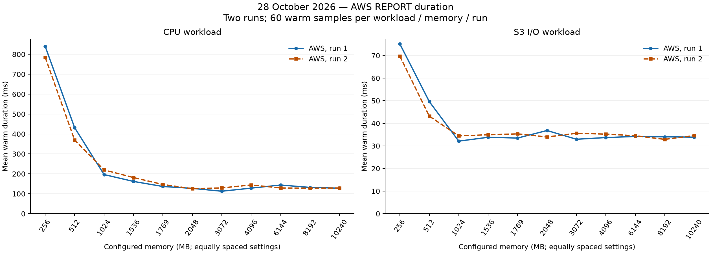
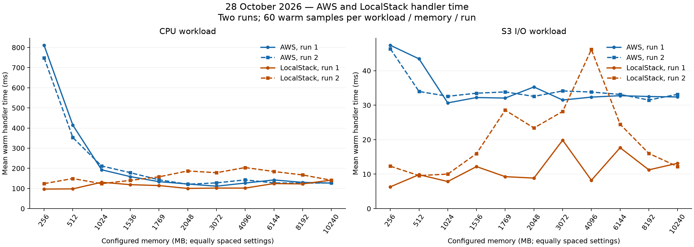
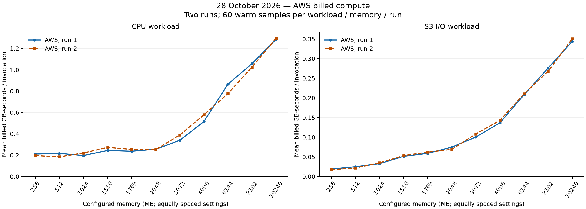

# 28 October 2026: two complete benchmark runs

Each run contains 1,452 valid calls per environment across 11 memory settings. Each workload/memory combination has 60 warm collected samples and six warmups. AWS batches use eu-west-1. Earlier partial and default-only runs are excluded.

The first and second runs each used two AWS batches to preserve the 1,000-call limit. Memory and workload order reverse within each batch. Calls are sequential within each environment; AWS and LocalStack matrices were launched concurrently.

AWS REPORT duration, Java handler time and billed compute have separate graphs. LocalStack configured memory does not establish equivalent AWS CPU allocation or production performance. Billed GB-seconds exclude request, S3 and logging costs.

## AWS REPORT duration

[SVG](aws-duration.svg)

## AWS and LocalStack handler time

[SVG](handler-comparison.svg)

## AWS billed compute

[SVG](aws-compute.svg)

[Measurements, including p95](measurements.csv) · [Source run folders](sources.json)

The CSV retains every plotted value. Regenerating these graphs with `scripts/plot-benchmark-runs.py` requires the raw invocation evidence kept locally; per-invocation files are excluded from the compact published commit.
